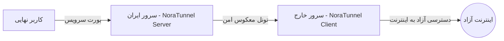

# 🚀 NoraTunnel (v3.0.0)

<div align="center">

```
    _   __                 ______                          __
   / | / /___  _________ _/_  __/_  ______  ____  ___     / /
  /  |/ / __ \/ ___/ __ `/ / / / / / / __ \/ __ \/ _ \   / / 
 / /|  / /_/ / /  / /_/ / / / / /_/ / / / / / / /  __/  / /  
/_/ |_/\____/_/   \__,_/ /_/  \__,_/_/ /_/_/ /_/\___/  /_/   
```

**High-Performance Reverse Tunnel & Traffic Relay System**  
*Optimized for extreme throughput, low latency, and censorship resilience.*

[](https://github.com/TacTic-A/NoraTunnel/releases)
[](LICENSE)
[-orange.svg)]()
[]()

[English](#-english) | [فارسی](#-راهنمای-فارسی)

---

</div>

## 📖 فهرست مطالب / Table of Contents
- [معرفی و ویژگی‌ها](#-معرفی-و-ویژگیها)
- [نصب سریع (One-Line Install)](#-نصب-سریع-one-line-install)
- [راهنمای راه‌اندازی گام‌به‌گام](#-راهنمای-راهاندازی-گامبهگام)
- [دستورات و کلیدهای میانبر](#-دستورات-و-کلیدهای-میانبر)
- [بهینه‌سازی شبکه و کرنل](#-بهینهسازی-شبکه-و-کرنل)
- [English Documentation](#-english)

---

## 🌟 معرفی و ویژگی‌ها

**نورا تانل (NoraTunnel)** یک سیستم مدیریت و برقراری تونل معکوس (Reverse Tunnel) پرسرعت است که به طور اختصاصی جهت رله و دور زدن فیلترینگ و اختلالات شبکه بین **سرور ایران** و **سرور خارج** طراحی شده است. این ابزار از موتور باینری بهینه‌شده به زبان Rust بهره می‌برد و کمترین مصرف رم و پردازنده (زیر ۱۵ مگابایت رم) را دارد.

### قابلیت‌های کلیدی:
- ⚡ **سرعت فوق‌العاده و سربار ناچیز:** عملکرد فوق‌العاده بالا به لطف هسته سبک Rust با بافرهای بهینه‌سازی‌شده.
- 🔒 **امنیت بالا:** احراز هویت توکن‌های تصادفی ۲۵۶ بیتی به ازای هر تونل.
- 🌐 **پشتیبانی کامل از IPv4 و IPv6:** امکان برقراری تونل بر بستر پروتکل‌های نسخه ۴ و ۶.
- 🔀 **انتقال چند پورت همزمان (Multi-Port):** تعریف و هدایت نامحدود پورت‌های TCP و UDP با علامت کاما.
- ⏱️ **کران‌جاب ایزوله (Zero-Interruption Cron):** ری‌استارت زمان‌بندی‌شده هر تونل به صورت مستقل بدون قطع کردن یا بستن سایر تونل‌های فعال روی سرور.
- 🚀 **نصب دائمی در سیستم (CLI Shortcut):** دسترسی به منو از هر مسیر در ترمینال با تایپ دستور کوتاه `nora` یا `noratunnel`.
- 📊 **مانیتورینگ و مشاهده اتصالات زنده:** بررسی پورت‌های در حال گوش دادن و مشاهده لحظه‌ای اتصالات فعال شبکه.
- 🛠️ **بهینه‌ساز پیشرفته شبکه:** اعمال الگوریتم BBR، تنظیم صف‌های FQ-Codel و افزایش سقف File Descriptors تا ۱,۰۴۸,۵۷۶ در Systemd.

---

## ⚡ نصب سریع (One-Line Install)

برای نصب یا اجرای مستقیم NoraTunnel روی سرور لینوکس (اوبونتو، دبیان، آلمالینوکس، راکی و ...)، تنها دستور زیر را در ترمینال با دسترسی روت اجرا کنید:

```bash
bash <(curl -fsSL https://raw.githubusercontent.com/TacTic-A/NoraTunnel/main/NoraTunnel.sh)
```

> **نکته:** پس از یک‌بار اجرای اسکریپت، دیگر نیازی به وارد کردن دستور طولانی بالا ندارید؛ در هر کجای سرور کافیست بنویسید:
> ```bash
> nora
> ```

---

## 🛠️ راهنمای راه‌اندازی گام‌به‌گام



### ۱. گام اول: سرور ایران (IRAN Server)
1. وارد سرور ایران شوید و دستور `nora` را اجرا کنید.
2. گزینه **`1. Configure a new NoraTunnel`** را انتخاب کنید.
3. گزینه **`1) Configure as IRAN Server`** را انتخاب کنید.
4. تنظیمات زیر را وارد نمایید:
   - **IPv6:** انتخاب کنید که آیا مایلید روی IPv6 نیز گوش دهد یا خیر.
   - **Tunnel Port:** یک پورت آزاد برای ارتباط بین دو سرور وارد کنید (مثلاً `2080`).
   - **TCP_NODELAY & Heartbeat:** اینتر بزنید تا روی مقادیر پیش‌فرض بهینه تنظیم شود.
   - **Service Ports:** پورت‌هایی که می‌خواهید منتقل شوند را با کاما وارد کنید (مثلاً `443,2053,8080`).
   - **Security Token:** کلید اینتر را بزنید تا یک توکن رمزنگاری‌شده قوی به صورت خودکار تولید شود.
5. پس از پایان، یک **باکس راهنما** شامل IP سرور ایران، پورت تونل و توکن امنیتی نمایش داده می‌شود. این اطلاعات را کپی کنید.

### ۲. گام دوم: سرور خارج (KHAREJ Server)
1. وارد سرور خارج شوید و دستور `nora` را اجرا کنید.
2. گزینه **`1. Configure a new NoraTunnel`** را انتخاب کنید.
3. این‌بار گزینه **`2) Configure as KHAREJ Server`** را بزنید.
4. مقادیر را مطابق اطلاعات کپی‌شده از سرور ایران پر کنید:
   - **IRAN Server IP:** آی‌پی سرور ایران را وارد کنید.
   - **Tunnel Port:** همان پورت تونلی که در سرور ایران زدید (مثلاً `2080`).
   - **Security Token:** همان توکن تولید شده در سرور ایران.
   - **Ports:** همان پورت‌های سرویس (مثلاً `443,2053,8080`).
5. تمام! تونل با موفقیت بالا آمده و به صورت سرویس دائمی Systemd فعال است.

---

## 🎛️ دستورات و کلیدهای میانبر

| دستور | عملکرد |
| :--- | :--- |
| `nora` | باز کردن منوی اصلی مدیریت نورا تانل |
| `noratunnel` | دستور جایگزین برای باز کردن منو |
| `systemctl status noratunnel-iran<PORT>` | بررسی وضعیت سرویس در سرور ایران |
| `systemctl status noratunnel-kharej<PORT>` | بررسی وضعیت سرویس در سرور خارج |
| `journalctl -u noratunnel-iran<PORT> -f` | مشاهده لاگ‌های زنده تونل |

---

## ⚙️ بهینه‌سازی شبکه و کرنل (BBR Optimizer)

در منوی اصلی با انتخاب گزینه **`4. Optimize Network & System Limits`**، تنظیمات حرفه‌ای زیر روی سرور اعمال می‌شود:
- فعال‌سازی الگوریتم کنترل ازدحام **BBR** گوگل برای کاهش پکت‌لاس و افزایش پهنای باند.
- افزایش بافرهای TCP Send/Receive تا ۳۲ مگابایت.
- افزایش صف‌های کانکشن‌های معلق (`somaxconn` = 65536).
- افزایش سقف فایل‌های باز (`ulimit -n 1048576`).

---

<br>

<div align="center">

## 🌐 English

</div>

### Overview
**NoraTunnel** is an automated reverse tunnel orchestrator engineered for bypassing network censorship and relaying traffic with maximum stability and minimal latency.

### Installation
Run the following single command on any modern Linux server:
```bash
bash <(curl -fsSL https://raw.githubusercontent.com/TacTic-A/NoraTunnel/main/NoraTunnel.sh)
```
Once installed, execute `nora` from anywhere in your shell to access the control interface.

### Features
- **Zero-Latency Rust Engine:** Uses high-throughput lightweight binaries.
- **Automated Service Management:** Seamless `systemd` integration with auto-recovery on failure.
- **Dynamic Port Bridging:** Support for forwarding multiple TCP/UDP ports simultaneously.
- **Isolated Health Checks:** Per-tunnel automated cron restarts without impacting other operational tunnels.
- **Kernel Tuning:** Built-in TCP BBR congestion control and socket buffer scaling.

---

## 📄 License
This project is licensed under the [MIT License](LICENSE) - feel free to use, modify, and distribute.
